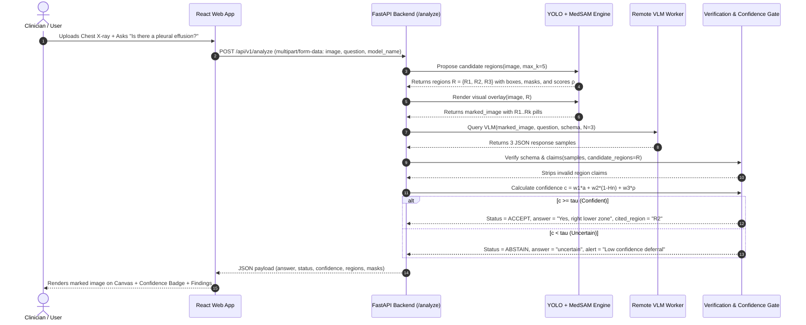

# End-to-End Data Flow Specification

This document details the sequence of operations, data structures, and state transitions during an inference request.

---

## 1. Sequence Diagram: Clinical Query Processing



---

## 2. API Contract & Data Schemas

### 2.1 Request Payload (`POST /api/v1/analyze`)
* `image`: Multipart file upload (JPEG/PNG/DICOM).
* `question`: String (e.g., *"Is there cardiomegaly?"*).
* `model_name`: Enum (`"qwen2.5-vl-3b"`, `"medgemma-4b"`, `"both"`).
* `sampling_n`: Integer (default: 3; range: 1–10).

### 2.2 Internal VLM Structured Prompt & Response Schema
```json
{
  "answer": "Yes, right lower zone",
  "findings": [
    {
      "claim": "pleural effusion",
      "region_id": "R2",
      "confidence": "high"
    }
  ]
}
```

### 2.3 Response Payload (`POST /api/v1/analyze`)
```json
{
  "request_id": "req-987a-4c2b",
  "question": "Is there a pleural effusion?",
  "model": "qwen2.5-vl-3b",
  "status": "ACCEPTED",
  "final_answer": "Yes, right lower zone",
  "is_abstaining": false,
  "confidence_score": 0.842,
  "confidence_breakdown": {
    "agreement": 1.0,
    "normalized_entropy": 0.0,
    "localizer_score": 0.89
  },
  "regions": [
    {
      "region_id": "R1",
      "box_2d": [120, 140, 260, 310],
      "score": 0.92,
      "mask_rle": "..."
    },
    {
      "region_id": "R2",
      "box_2d": [340, 420, 480, 560],
      "score": 0.89,
      "mask_rle": "..."
    }
  ],
  "findings": [
    {
      "claim": "pleural effusion",
      "region_id": "R2",
      "is_grounded": true,
      "localizer_score": 0.89
    }
  ]
}
```
If $c < \tau$, `"status"` becomes `"ABSTAINED"`, `"final_answer"` becomes `"uncertain"`, and `"is_abstaining"` is `true`.
